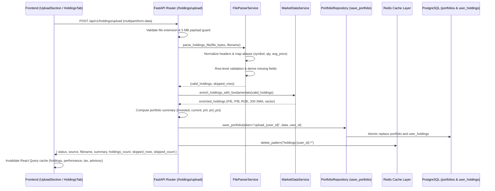

# Low-Level Design — 12: CSV and Excel Holdings Ingestion

**Module:** Portfolio Ingestion & File Parsing  
**Issue:** [#20 — Add CSV/Excel upload feature for holdings](https://github.com/benoirajan/portfolio-assistant/issues/20)  
**Files Covered:**
- `backend/src/services/file_parser.py`
- `backend/src/api/holdings.py`
- `backend/requirements.txt`
- `backend/tests/test_file_upload.py`
- `backend/tests/fixtures/*`
- `frontend/components/tabs/UploadSection.tsx`
- `frontend/components/tabs/HoldingsTab.tsx`
- `frontend/lib/api.ts`, `frontend/lib/types.ts`

---

## 1. Architectural Overview

To onboard users without requiring live Zerodha broker credentials (or to support offline portfolio simulation and non-Kite broker exports such as Groww or Upstox), the application provides a robust file ingestion pipeline for `.csv`, `.xlsx`, and `.xls` files.

### Ingestion Sequence



---

## 2. Ingestion Rules & Column Alias Mapping

### Required Internal Schema (`UserHolding`)

Every valid row requires:
- `tradingsymbol` (string, non-empty, uppercase)
- `quantity` (integer, strictly > 0)
- `average_price` (float, strictly > 0)

### Column Normalization & Cleansing Pipeline

Headers from broker exports often include punctuation (e.g. `Qty.`, `Avg. cost`), parenthesized currency units (`(₹)`, `(Rs.)`), slashes (`Profit/Loss`), or trailing empty commas resulting in `Unnamed: 9`. The parser applies a multi-stage cleansing pipeline:

1. **Unnamed & Blank Column Pruning:** Drops any column whose name starts with `unnamed` or is whitespace-only.
2. **Header Normalization (`normalize_column_name`):**
   - Strips parenthesized units: `re.sub(r"\(.*?\)", "", col)`
   - Strips dots: `col.replace(".", "")` (converting `Qty.` $\to$ `qty`, `Avg. cost` $\to$ `avg cost`)
   - Replaces slashes, hyphens, and whitespace with single underscores (`_`)
   - Lowercases and trims leading/trailing underscores
3. **Numeric Sanitization (`_clean_number`):**
   - Strips currency symbols (`₹`, `$`), commas (`1,000` $\to$ `1000`), and whitespace before numeric conversion, preventing `ValueError` exceptions on formatted numbers.

### Supported Column Aliases

The parser performs case-insensitive, whitespace-trimmed mapping:

```python
COLUMN_ALIASES = {
    # tradingsymbol
    "symbol": "tradingsymbol",
    "trading_symbol": "tradingsymbol",
    "stock": "tradingsymbol",
    "scrip": "tradingsymbol",
    "instrument": "tradingsymbol",
    "ticker": "tradingsymbol",
    "name": "tradingsymbol",
    "stock_name": "tradingsymbol",
    "stock_symbol": "tradingsymbol",
    "company": "tradingsymbol",
    "company_name": "tradingsymbol",
    "security": "tradingsymbol",
    # exchange
    "exch": "exchange",
    "market": "exchange",
    # quantity
    "qty": "quantity",
    "shares": "quantity",
    "units": "quantity",
    "holding_quantity": "quantity",
    "total_quantity": "quantity",
    "current_qty": "quantity",
    "available_qty": "quantity",
    "net_qty": "quantity",
    "quantities": "quantity",
    # average_price
    "avg_price": "average_price",
    "avg_cost": "average_price",
    "buy_price": "average_price",
    "cost_price": "average_price",
    "purchase_price": "average_price",
    "buy_avg": "average_price",
    "buy_average": "average_price",
    "buy_avg_price": "average_price",
    "avg": "average_price",
    "cost": "average_price",
    "avg_cost_price": "average_price",
    "average_cost": "average_price",
    # last_price
    "ltp": "last_price",
    "current_price": "last_price",
    "market_price": "last_price",
    "cmp": "last_price",
    "close_price": "last_price",
    "closing_price": "last_price",
    "last_traded_price": "last_price",
    # pnl
    "profit": "pnl",
    "p&l": "pnl",
    "p_l": "pnl",
    "pl": "pnl",
    "profit_loss": "pnl",
    "unrealized_pnl": "pnl",
    "unrealised_pnl": "pnl",
    "net_pnl": "pnl",
    "total_pnl": "pnl",
    # isin
    "isin_code": "isin",
}
```

### Fallbacks & Derived Fields
- If `exchange` is omitted, defaults to `"NSE"`.
- If `last_price` is omitted or zero, defaults to `average_price`.
- If `pnl` is omitted, computed as `(last_price - average_price) * quantity`.
- If `pnl_percentage` is omitted, computed as `((last_price - average_price) / average_price) * 100`.

### Row-Level Skip Semantics
Instead of rejecting the entire upload when encountering a corrupt row (e.g. an empty summary row at the bottom of an Excel export), invalid rows are collected in `skipped_rows` with the row index, the reason for rejection, and the raw row contents. If no valid rows exist, a `422 Unprocessable Entity` is returned.

---

## 3. Backend Implementation

### `backend/src/services/file_parser.py`
Exposes `FileParserService`:
- `parse_holdings_file(file_bytes: bytes, filename: str) -> Tuple[List[Dict[str, Any]], List[Dict[str, Any]]]`
- Rejects files > 5 MB (`FileParserError`).
- Uses `pandas.read_csv` for `.csv` and `pandas.read_excel` with `openpyxl` engine for `.xlsx`/`.xls`.

### `backend/src/api/holdings.py`
Exposes `POST /api/v1/holdings/upload`:
- Protected by `get_current_user` JWT dependency.
- Accepts `UploadFile = File(...)`.
- Enriches parsed holdings with fundamentals via `market_data_service.enrich_holdings_with_fundamentals()`.
- Persists data with tenant isolation via `save_portfolio(token_identifier, portfolio_data, user_id=current_user.id)`.
- Purges user cache via `cache.delete_pattern(f"holdings:{current_user.id}:*")`.

---

## 4. Frontend Implementation

### `frontend/components/tabs/UploadSection.tsx`
- Modern drag-and-drop file zone with dashed border, active drag highlighting, and file type / size validation.
- File picker button triggering native file dialog.
- Progress spinner during upload and enrichment.
- Success card summarizing positions imported, total investment, current value, and unrealized P&L.
- Expandable drawer for skipped rows when formatting issues occur in specific lines.
- Automatic query invalidation:
  ```typescript
  await Promise.all([
    queryClient.invalidateQueries({ queryKey: ['holdings'] }),
    queryClient.invalidateQueries({ queryKey: ['performance'] }),
    queryClient.invalidateQueries({ queryKey: ['tax'] }),
    queryClient.invalidateQueries({ queryKey: ['advisory'] }),
  ])
  ```

### `frontend/components/tabs/HoldingsTab.tsx`
- If `holdings.length === 0`: renders a dedicated empty state banner with the upload dropzone prominently displayed.
- If `holdings.length > 0`: renders an "Import CSV/Excel" action button alongside the search and sector filters, opening a collapsible upload drawer.

---

## 5. Verification & Testing

### Test Suite (`backend/tests/test_file_upload.py`)
13 dedicated unit and integration tests:
- `test_parse_valid_csv`: Standard Zerodha export parsed into valid holdings.
- `test_parse_aliased_columns`: Normalized headers (`symbol`, `qty`, `avg_price`, `ltp`).
- `test_skip_invalid_rows`: Negative quantities, empty symbols, non-numeric prices skipped cleanly without aborting file.
- `test_derived_pnl_when_missing`: P&L and percentage formulas.
- `test_default_last_price_to_average_price`: Fallback when LTP absent.
- `test_default_exchange_to_nse`: Default market assignment.
- `test_missing_required_columns_raises`: Unprocessable error when required columns absent.
- `test_empty_file_raises`: Empty payload error handling.
- `test_file_size_guard`: Rejection of files exceeding 5 MB limit.
- `test_unsupported_extension`: Rejection of non-spreadsheet extensions.
- `test_parse_xlsx`: Binary Excel file parsing using `openpyxl`.
- `test_case_insensitive_columns`: Uppercase/mixed header support (`TRADING_SYMBOL`, `QUANTITY`).
- `test_whitespace_in_columns`: Whitespace padding removal in column names.
