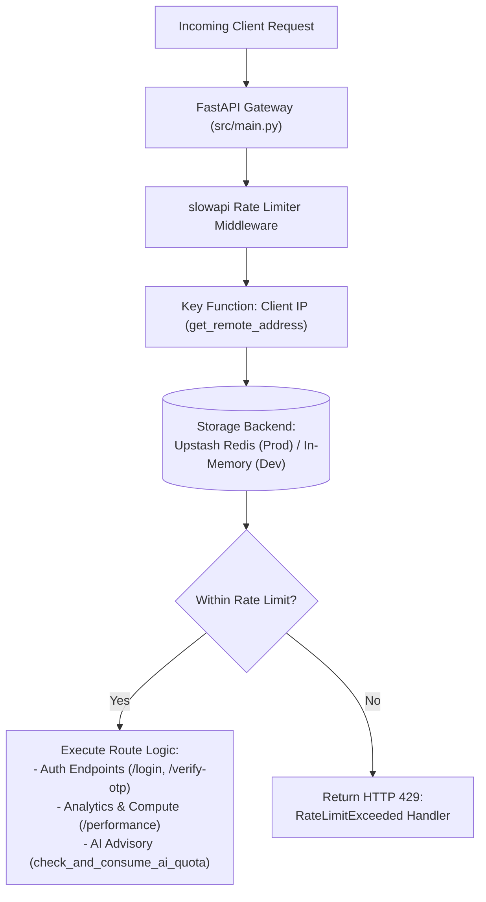

# Low-Level Design — 14: HTTP Rate Limiting & API Quota Protection

**Module:** HTTP Rate Limiting & Abuse Prevention  
**Phase:** Security Hardening (Audit Category 2 — CRIT-03 & CRIT-04)  
**Files Covered:**
- `backend/requirements.txt`
- `backend/src/core/rate_limit.py`
- `backend/src/main.py`
- `backend/src/api/auth.py`
- `backend/src/api/advisory.py`
- `backend/src/api/analytics.py`
- `backend/tests/test_rate_limiting.py`

---

## 1. Architectural Overview

Prior to this implementation, FolioGuard lacked application-level HTTP rate limiting. This left sensitive authentication and expensive computation endpoints vulnerable to:
1. **OTP Brute-Force & Credential Stuffing:** Unbounded attempts against `/verify-otp`, `/resend-otp`, and `/login`.
2. **AI & Financial API Cost Spikes:** Direct calls to Google Gemini (`/recommendations`), Zerodha KiteConnect, and Yahoo Finance with no request throttling.
3. **Denial-of-Service / Resource Starvation:** CPU-bound portfolio performance computations (XIRR, Sharpe, Sortino) could be repeatedly triggered.

The rate limiting infrastructure introduces a centralized `slowapi` limiter backed by Redis (with graceful in-memory fallback) and explicit AI quota gating on single-stage advisory.



---

## 2. Centralized Rate Limiter (`backend/src/core/rate_limit.py`)

A dedicated module creates a decoupled `limiter` instance, avoiding circular import cycles between `main.py` and API routers:

```python
from slowapi import Limiter
from slowapi.util import get_remote_address
from src.core.config import settings

def _get_storage_uri() -> str | None:
    if settings.REDIS_URL:
        return settings.REDIS_URL
    return None

limiter = Limiter(
    key_func=get_remote_address,
    storage_uri=_get_storage_uri(),
    default_limits=["200/minute"],  # Global safety net
)
```

- **Identification Key:** Client IP address via `get_remote_address`.
- **Storage:** Upstash / Local Redis URI via `settings.REDIS_URL`. If unset, defaults to local memory.
- **Global Default:** 200 requests/minute for undeclared routes.

---

## 3. Rate Limit Enforcement Matrix

| Endpoint | Method | Rate Limit | Protection Target |
|---|---|---|---|
| `/api/v1/auth/login` | `POST` | `10/minute` | Credential stuffing / password dictionary attacks |
| `/api/v1/auth/verify-otp` | `POST` | `5/minute` | 6-digit OTP brute-force lockout |
| `/api/v1/auth/resend-otp` | `POST` | `3/minute` | Email delivery throttling / notification spam |
| `/api/v1/auth/register` | `POST` | `5/minute` | Bulk bot registration spam |
| `/api/v1/auth/google` | `POST` | `10/minute` | Google IAM token exchange flooding |
| `/api/v1/advisory/recommendations` | `GET` | `10/minute` | Gemini AI LLM call quota abuse |
| `/api/v1/advisory/pipeline` | `GET` | `5/minute` | 3-stage heavy pipeline execution abuse |
| `/api/v1/advisory/stream` | `GET` | `5/minute` | Persistent SSE connection flood |
| `/api/v1/analytics/performance` | `GET` | `10/minute` | CPU-intensive XIRR / Sharpe computation |

---

## 4. Advisory Quota Enforcement (CRIT-04)

In addition to HTTP rate limiting, `GET /api/v1/advisory/recommendations` now uses the `check_and_consume_ai_quota` dependency:

```python
@router.get("/recommendations")
@limiter.limit("10/minute")
def recommendations(
    request: Request,
    ...,
    current_user: User = Depends(check_and_consume_ai_quota),
):
    ...
```

This closes the bypass vulnerability where FREE tier users could invoke single-stage recommendations repeatedly without decrementing their monthly Gemini AI quota.

---

## 5. Verification & Testing

Tests are housed in `backend/tests/test_rate_limiting.py`:
- `test_rate_limiter_exceeded_returns_429`: Verifies hitting `/resend-otp` 4 times in 1 minute triggers HTTP 429 `Rate limit exceeded`.
- `test_advisory_recommendations_enforces_ai_quota_gate`: Introspects the route dependencies of `/recommendations` to assert `check_and_consume_ai_quota` is strictly attached.

