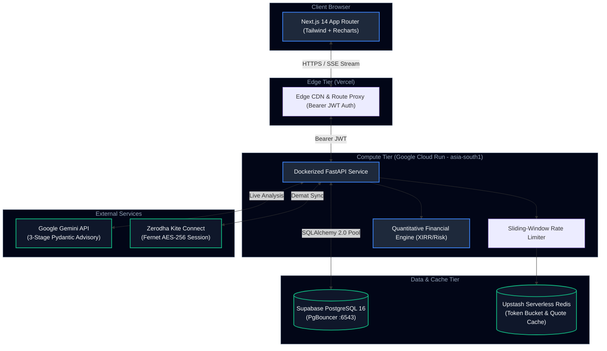

# FolioGuard — LinkedIn Campaign: Week 1, Post 2 (Hybrid Cloud Architecture)

> **Campaign Phase:** Week 1 — System Introduction & Architecture  
> **Post Number:** 2 of 10  
> **Target Day:** Thursday  
> **Ideal Posting Window:** 08:30 AM – 09:30 AM IST (or 06:30 PM – 07:30 PM IST)  
> **Author:** Benoi Rajan  
> **Core Objective:** Showcase clean, modern cloud architecture and cost-effective distributed systems design; attract engineering managers, tech leads, and backend/cloud architects.  
> **Key Visual Asset:** Cloud Architecture Diagram / 3D Cloud Topology Graphic ([Visual Prompts Below](#-visual-assets--image-generation-prompts))

---

## 📱 Final LinkedIn Post Copy (Ready to Publish)

*(Copy and paste the exact text below into LinkedIn)*

```text
How do you build a cloud-native fintech platform handling live broker data, AI inference, and relational persistence with virtually zero monthly cloud bills?

Most founders and solo engineers over-engineer their infrastructure early:
• Heavy Kubernetes clusters running idle pods
• Always-on dedicated DB instances burning $40–$80/month
• Microservices communicating over slow, expensive REST hops

When architecting FolioGuard, I designed a "Hybrid Butterfly" topology that delivers high performance, cold-start resilience, and auto-scaling — without paying for idle compute.

Here is the exact production architecture:

1. 🌐 The Edge Tier (Next.js 14 on Vercel Edge)
• Server-side rendering (SSR) and edge-cached static assets for instantaneous TTFB.
• API route proxying with zero token leakage — all client requests authenticate via Bearer JWT.
• Real-time SSE (Server-Sent Events) consumer for streaming 3-stage AI advisory suggestions.

2. ⚡ The Compute Tier (FastAPI on Google Cloud Run)
• Fully containerized Python service deployed in GCP Mumbai (asia-south1) for sub-25ms latency to Indian broker APIs.
• Scales down to exact zero instances when idle, spinning up in seconds under load.
• CPU throttling enabled outside requests, driving idle compute costs to $0.00.

3. 🗄️ The Data & Cache Tier (Supabase + Upstash Redis)
• Managed PostgreSQL 16 hosted on Supabase, connected through port 6543 transaction pooling (PgBouncer) to prevent connection starvation during Cloud Run concurrency spikes.
• Upstash Serverless Redis for sliding-window rate limiting (10 req/min per user on expensive LLM routes) and live quote caching.

4. 🧠 The Intelligence & Ingestion Tier
• Google Gemini API (google-genai) executing 3-stage deterministic + LLM portfolio audits with strict Pydantic JSON schemas.
• Zerodha Kite Connect SDK integrated with AES-256 encrypted session tokens (enctoken) stored at rest.

5. 🛡️ Continuous Delivery & Quality Gates
• GitHub Actions CI/CD automatically building Docker images into GCP Artifact Registry.
• 49 automated unit and integration tests executing on every commit.

Architecture isn't about how many AWS or GCP services you can stitch together — it's about choosing the right abstraction layer for every workload.

How do you optimize your cloud footprint for side projects and early-stage SaaS? Do you go all-in on a single cloud, or embrace a serverless multi-cloud approach?

Drop your thoughts below! 👇

#systemdesign #cloudnative #gcp #vercel #softwarearchitecture #microservices #python #fastapi #nextjs #fintech #devops #buildinpublic
```

---

## 💬 First Comment Templates (Choose One)

### Option 1: Architecture Deep-Dive & Live App Link (Recommended)
```text
Curious to test the speed and responsiveness of this setup?

🌐 Live Demo: https://portfolio-assistant-rouge.vercel.app
💻 GitHub Repo: https://github.com/benoirajan/portfolio-assistant

Key Infrastructure Metrics:
• Edge TTFB: < 60ms globally via Vercel Edge
• Backend API Latency: ~35ms avg (P95 < 120ms) within asia-south1
• Monthly Hosting Cost: $0.00 on current traffic tiers

If you want a breakdown of the PgBouncer connection pooling config or Upstash rate-limiter implementation, let me know!
```

### Option 2: Engagement & Architecture Diagram Handout
```text
🌐 Try the live app here: https://portfolio-assistant-rouge.vercel.app

I documented the full system architecture, database schema, and Cloud Run Docker configuration in the repository.

Want the high-res architecture schematic and GCP setup guide? Comment "ARCH" below and I'll DM you the direct docs!
```

---

## 🎨 Visual Assets & Image Generation Prompts

To make this post perform well on LinkedIn, pair it with one of the visual options below:

### Option A: Clean Mermaid Architecture Diagram (Native & Crisp)
*You can render this in [mermaid.live](https://mermaid.live) or export it as a clean SVG/PNG to attach directly:*



---

### Option B: AI Image Generation Prompts (Midjourney / DALL-E 3 / Imagen 3)

#### Prompt 1: Isometric 3D Dark-Mode Cloud Architecture (Recommended)
```text
An isometric 3D render of a futuristic cloud computing architecture on a sleek dark slate background. Glowing neon nodes connected by fiber optic light beams representing distributed systems. In the center, a luminous hexagonal hub representing a FastAPI microservice on Google Cloud, connected via glowing blue data streams to a Vercel edge globe, a green glowing PostgreSQL database node with cylindrical layers, an Upstash Redis lightning bolt cache icon, and a radiant purple Google Gemini AI neural network icon. High-tech fintech dashboard aesthetics, ultra-sharp 8k resolution, minimalist modern enterprise UI style, glowing accents, cinematic ambient lighting, octane render --ar 16:9
```

#### Prompt 2: Minimalist Fintech Engineering Infographic
```text
A modern minimalist software architecture visual for a high-performance fintech app, dark graphite background with electric blue, cyan, and emerald green accents. Clean modular glassmorphism cards representing Next.js Edge, Google Cloud Run serverless container, Supabase Postgres database, Upstash Redis cache, and Gemini AI. Crisp typography, subtle glowing data pipeline arrows, network topology graph, professional tech LinkedIn graphic, clean vector 3D aesthetic, 8k --ar 1200:627
```

#### Prompt 3: Cybernetic Butterfly Cloud Blueprint (Metaphorical & Eye-Catching)
```text
A conceptual tech illustration of a glowing cybernetic butterfly composed of cloud server nodes and circuit board traces, floating in a dark digital space. Left wing represents frontend edge delivery (Vercel, Next.js, glowing cyan lines), right wing represents backend serverless compute and database persistence (GCP Cloud Run, PostgreSQL, Upstash Redis, glowing emerald and violet nodes). Data packets flowing through glowing arteries. Sleek, sophisticated developer aesthetic, unreal engine 5 render, depth of field, 8k --ar 16:9
```
